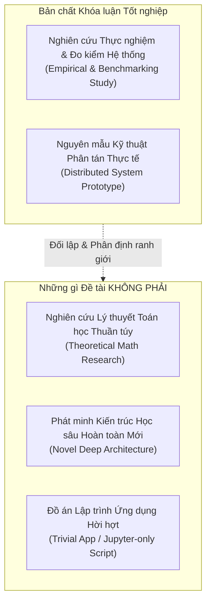

# 📌 Ghi chú 01: Định vị Bản chất & Phạm vi Khoa học của Khóa luận

> **Tài liệu tham chiếu nội bộ cho Khóa luận Tốt nghiệp:**  
> *Xây dựng và đánh giá Prototype hệ thống phát hiện xâm nhập IoT sử dụng Federated Learning trong môi trường dữ liệu Non-IID*  
> **Sinh viên thực hiện:** Nguyễn Việt Kỳ Quân — 23521267 | **CBHD:** PGS. TS. Lê Trung Quân

---

## 1. Bản chất Cốt lõi của Công trình (Nature of the Work)

Trong nghiên cứu khoa học máy tính và kỹ thuật mạng, việc xác định chính xác "vị trí bản thể luận" (Ontological positioning) của đề tài là yếu tố then chốt giúp sinh viên tự tin, không bị lệch hướng và không bị hội đồng bắt bẻ lỗi ngụy biện (over-claiming).

### 1.1. Công trình này LÀ GÌ?
1. **Một nghiên cứu thực nghiệm và đo kiểm chuẩn mực (Empirical & Benchmarking Study):**
   - Đặt mô hình Federated Learning (FedAvg, FedProx) vào điều kiện khắc nghiệt của dữ liệu an ninh mạng IoT (CICIoT2023) với phân phối nhãn bị lệch pha nghiêm trọng (Non-IID Dirichlet $\alpha \in \{1.0, 0.5, 0.1\}$) và mất cân bằng lớp cực đoan (Class Imbalance).
   - Đo lường có kiểm soát (controlled experiment) trên môi trường holdout test độc lập (30%) để thu được số liệu khách quan, trung thực.
2. **Một nguyên mẫu kỹ thuật phân tán hoàn chỉnh (Distributed System Prototype):**
   - Hiện thực hóa kiến trúc Client-Server thực tế giao tiếp qua **gRPC binary protocol** trên nền tảng Flower framework.
   - Các client hoạt động như các tiến trình độc lập (`multiprocessing`), quản lý chu kỳ sống (lifecycle), tải bộ nhớ, và tham số mô hình riêng biệt.

### 1.2. Công trình này KHÔNG PHẢI LÀ GÌ?
- **Không phải nghiên cứu lý thuyết toán học:** Không chứng minh bổ đề hội tụ mới, không phát minh ra toán tử tối ưu hóa mới.
- **Không phải phát minh kiến trúc AI đột phá:** Sử dụng mạng MLP chuẩn tối ưu cho trạm IoT biên thay vì các mô hình khổng lồ (Transformer/LLM) không thực tế trên thiết bị nhúng.
- **Không phải đồ án "mô phỏng trên giấy":** Không phải là notebook chạy vòng lặp `for` gộp mảng dữ liệu trong RAM một cách giả lập, mà chạy qua network socket gRPC thật.

---

## 2. Phân định Giá trị Kỹ thuật Hệ thống (Engineering) vs. Đóng góp Khoa học (Scientific Value)

Một sai lầm phổ biến của sinh viên là đánh đồng **công sức lập trình** với **đóng góp học thuật**. Cần phân biệt rành mạch:

| Yếu tố | Năng lực Kỹ thuật (Engineering Capability) | Giá trị Đóng góp Khoa học (Scientific Contribution) |
| :--- | :--- | :--- |
| **Bản chất** | Kỹ năng giải quyết bài toán kỹ thuật, tối ưu tài nguyên, vận hành mã nguồn chạy trơn tru. | Tri thức mới, phát hiện mới, dữ liệu định lượng có thể kiểm chứng độc lập. |
| **Ví dụ trong đề tài** | • Tối ưu pipeline tránh deadlock pipe buffer 64KB của Linux bằng file logging. • Quản lý bộ nhớ VRAM/RAM GPU trên Colab, giải phóng biến trung gian tránh OOM. • Đóng gói script chạy $K=10$ tiến trình song song qua socket gRPC. | • **Bằng chứng phản nghiệm (Negative Finding):** Cơ chế trung bình trọng số của FedAvg/FedProx hoàn toàn vô hiệu trước lớp tấn công cực hiếm ($<0.5\%$). • **Đường cong suy thoái Dirichlet:** Xác định ngưỡng gãy đổ định lượng $\alpha=0.5$. • **Tam giác đánh đổi:** Đo lường chính xác Utility vs. Footprint (54 KB) vs. Scalability ($K=10$). |
| **Giá trị đối với Hội đồng** | Điều kiện cần để chứng minh sinh viên có năng lực thực hành và hiện thực hóa hệ thống. | Điều kiện đủ để đạt điểm xuất sắc về tư duy nghiên cứu và tính khoa học. |

---

## 3. Tuyên bố Phạm vi (Scope & Assumptions)

Để bảo vệ thành công trước các câu hỏi phản biện, sinh viên cần công bố trước các giả định và phạm vi nghiên cứu:

1. **Về dữ liệu:** Nghiên cứu sử dụng tập dữ liệu CICIoT2023, phân nhóm thành 8 lớp tấn công đại diện (DDoS, DoS, Recon, Web, BruteForce, Spoofing, Mirai, Benign). Toàn bộ tiền xử lý (fit scaler) chỉ thực hiện trên tập Train để triệt tiêu hoàn toàn rò rỉ dữ liệu (Data Leakage).
2. **Về mô hình:** Tập trung vào kiến trúc mạng nơ-ron truyền thẳng (MLP 14,088 tham số, kích thước ~54 KB), phù hợp với năng lực tính toán và năng lượng của Gateway/Router IoT.
3. **Về môi trường mạng:** Mô phỏng giao thức truyền thông qua giao diện mạng gRPC đa tiến trình trên máy chủ cục bộ (Local Host gRPC Network Interface), đóng vai trò bước đệm trước khi đưa lên mạng vật lý không dây.

> [!IMPORTANT]
> **Quy tắc vàng khi viết báo cáo và bảo vệ:**  
> Luôn thừa nhận đề tài là một **Nghiên cứu Thực nghiệm và Đo kiểm Hệ thống (Empirical Benchmarking & Prototype Study)**. Tránh tuyệt đối việc tự xưng đề xuất thuật toán mới khi chỉ áp dụng FedAvg/FedProx trên bài toán mới. Khiêm tốn về mặt lý thuyết, nhưng tự tin và đanh thép về mặt số liệu thực nghiệm!
