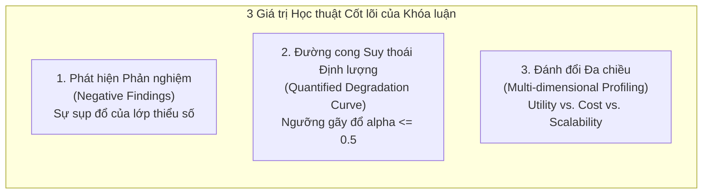
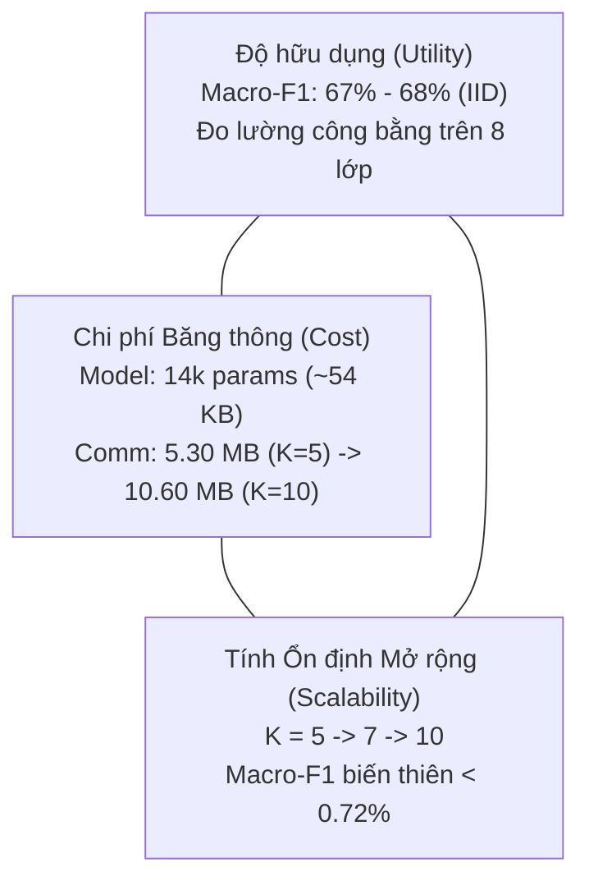

# 🔬 Ghi chú 02: Các Giá trị Khoa học Thực chất & Phát hiện Phản nghiệm (Negative Findings)

> **Tài liệu tham chiếu nội bộ cho Khóa luận Tốt nghiệp:**  
> *Xây dựng và đánh giá Prototype hệ thống phát hiện xâm nhập IoT sử dụng Federated Learning trong môi trường dữ liệu Non-IID*  
> **Sinh viên thực hiện:** Nguyễn Việt Kỳ Quân — 23521267 | **CBHD:** PGS. TS. Lê Trung Quân

---

## 1. Tổng quan 3 Đóng góp Khoa học Thực chất (The Real Merits)

Trong các hội đồng khoa học và các tạp chí chuyên ngành (như IEEE TNSM hay Computers & Security), các đóng góp có giá trị trích dẫn cao không nhất thiết phải là các thuật toán phức tạp, mà là **các phát hiện thực nghiệm định lượng có tính phản nghiệm (Empirical Counter-Evidence)** và **hệ thống đo kiểm có tính đối chứng nghiêm ngặt**.

Khóa luận này sở hữu 3 giá trị học thuật cốt lõi:



---

## 2. Đóng góp 1: Phát hiện Phản nghiệm về Sự Sụp đổ của Lớp Thiểu số (Negative Finding on Minority Attacks)

### 2.1. Hiện tượng Thực nghiệm
Trong bài toán giám sát an ninh mạng IoT (CICIoT2023), lưu lượng mạng có tính mất cân bằng tự nhiên cực đoan:
- Các lớp áp đảo (DDoS, DoS) chiếm $>80\%$ tổng số gói tin.
- Các lớp tấn công mục tiêu nguy hiểm nhưng xuất hiện với tần suất cực thấp: `Web-based` ($<0.5\%$) và `Brute Force` ($\approx 1.5\%$).

Bảng số liệu thực nghiệm thu được trên tập Holdout Test 30% độc lập:

| Kịch bản Thực nghiệm | Thuật toán | Cấu hình Phân vùng | Macro-F1 | Overall Acc | Recall: Web-based | Recall: Brute Force |
| :--- | :---: | :---: | :---: | :---: | :---: | :---: |
| `flower_e2_fedavg_iid` | FedAvg | IID ($K=5$) | 68.00% | 84.60% | **1.66%** | **20.57%** |
| `flower_e6_fedavg_iid_client=7` | FedAvg | IID ($K=7$) | 67.82% | 84.54% | **0.63%** | **21.10%** |
| `flower_e6_fedavg_iid_client=10`| FedAvg | IID ($K=10$) | 67.28% | 84.41% | **0.39%** | **19.21%** |
| `flower_e2_fedprox_mu=0.05_iid` | FedProx ($\mu=0.05$) | IID ($K=5$) | 59.06% | 80.09% | **0.00%** | **0.00%** |
| `flower_e3_fedprox_mu=0.05_alpha=1.0` | FedProx ($\mu=0.05$) | Non-IID ($\alpha=1.0$) | 55.45% | 77.41% | **0.00%** | **0.00%** |
| `flower_e4_fedprox_mu=0.05_alpha=0.5` | FedProx ($\mu=0.05$) | Non-IID ($\alpha=0.5$) | 53.01% | 75.99% | **0.00%** | **0.00%** |
| `flower_e5_fedprox_mu=0.05_alpha=0.1` | FedProx ($\mu=0.05$) | Non-IID ($\alpha=0.1$) | 43.01% | 70.12% | **0.00%** | **0.00%** |

### 2.2. Bản chất Cơ chế Toán học Gây ra Thất bại

```
                    ┌────────────────────────────────────────────────────────┐
                    │ CƠ CHẾ SỤP ĐỔ RECALL CỦA LỚP THIỂU SỐ (WEB-BASED)       │
                    └────────────────────────────────────────────────────────┘

    [Client 1, ..., K] Local Updates:
    Client k có vài mẫu Web-based: Cố gắng cập nhật gradient g_k hướng về lớp Web.
           │
           ├──> FEDAVG: Server tổng hợp: w = Σ (n_k / N) * w_k
           │    Do n_k(DDoS/DoS) >> n_k(Web), gradient của lớp đa số lấn át hoàn toàn.
           │    Gradient lớp Web bị triệt tiêu sau phép bình quân gia quyền.
           │    ==> Recall Web-based tụt thảm hại: 1.66% (K=5) --> 0.39% (K=10).
           │
           └──> FEDPROX: Hàm mất mát cục bộ: L_prox = L_ce + (μ/2) * ||w - w_t||^2
                Số hạng phạt proximal μ ghìm chặt trọng số client xung quanh w_t.
                Lực kéo này dập tắt hoàn toàn sự dịch chuyển tham số về hướng lớp thiểu số!
                ==> Recall Web-based & Brute Force bị kéo thẳng về 0.00%!
```

1. **Đối với FedAvg:** Công thức tổng hợp $w_{t+1} = \sum_{k=1}^K \frac{n_k}{N} w_{t+1}^k$ lấy trọng số theo kích thước tập dữ liệu $n_k$. Các client chứa phần lớn mẫu DDoS/DoS chiếm tỷ trọng áp đảo, dập tắt hoàn toàn vector gradient đại diện cho các lớp thiểu số. Ngay cả khi cục bộ áp dụng Class-weighted Cross-Entropy hay Focal Loss, tín hiệu gradient này vẫn bị hòa tan (diluted) khi tổng hợp toàn cục.
2. **Đối với FedProx:** Mục tiêu tối ưu của client $k$ là:
   $$\min_{w} h_k(w; w_t) = F_k(w) + \frac{\mu}{2} \|w - w_t\|^2$$
   Khi $\mu = 0.05$, số hạng phạt đóng vai trò như một "mỏ neo toán học" (mathematical anchor) cưỡng chế mô hình client không được đi quá xa mô hình toàn cục $w_t$. Tuy nhiên, để học được các đặc trưng hiếm của lớp `Web-based` hay `Brute Force`, client bắt buộc phải có sự dịch chuyển gradient đủ lớn. Lực phạt proximal đã dập tắt nỗ lực này, dẫn đến hiện tượng **tê liệt tính dẻo cục bộ (Loss of Local Plasticity)**, kéo tỷ lệ nhận diện hai lớp này về đúng **0.00%**.

> [!TIP]
> **Ý nghĩa Học thuật của Phát hiện này:**  
> Đây là bằng chứng phản biện thực nghiệm đanh thép (Empirical Counter-Evidence) chỉ ra rằng: **Không thể giải quyết vấn đề mất cân bằng lớp cực đoan trong FL chỉ bằng các giải pháp gán trọng số cục bộ (Focal Loss, Class Weights) kết hợp với các thuật toán tổng hợp tham số cổ điển (FedAvg, FedProx).**

---

## 3. Đóng góp 2: Vạch ra Đường cong Suy thoái Định lượng (Quantified Dirichlet Degradation Curve)

Hầu hết các nghiên cứu hiện nay chỉ thử nghiệm tại một điểm tùy tiện (thường là $\alpha=0.5$ hoặc phân vùng nhãn thủ công 2-class/client). Khóa luận đã thiết lập một chuỗi đối chứng bậc thang chặt chẽ:

$$\text{IID} \xrightarrow{\Delta = -0.38\%} \alpha = 1.0 \xrightarrow{\Delta = -2.89\%} \alpha = 0.5 \xrightarrow{\Delta = -21.72\%} \alpha = 0.1$$

```
   Macro-F1 (%)
   70% ─── 68.00% (IID) ─── 67.62% (α=1.0)
   60% ────────────────────────────────────── 64.73% (α=0.5 FedAvg)
   50% ────────────────────────────────────────────────── 53.01% (α=0.5 FedProx)
   40% ────────────────────────────────────────────────────────────────── 43.01% (α=0.1 FedProx)
        │                 │                 │                      │
       IID              α=1.0             α=0.5                  α=0.1
   [Đồng nhất]     [Lệch nhẹ]       [Ngưỡng gãy đổ]        [Phân cực cực đoan]
```

### Kết luận Khoa học Định lượng:
1. **Vùng an toàn ($\alpha \ge 1.0$):** Độ lệch phân phối nhẹ hầu như không ảnh hưởng đến khả năng khái quát hóa của mô hình toàn cục (suy giảm Macro-F1 $< 0.4\%$).
2. **Ngưỡng gãy đổ (Tipping Point $\alpha = 0.5$):** Mô hình bắt đầu suy giảm rõ rệt. Khoảng cách L2 drift tăng từ $10.21 \to 13.30$ ở FedAvg.
3. **Vùng sụp đổ phân tán ($\alpha = 0.1$):** Các client chỉ giữ 1–2 lớp nhãn đặc thù. Việc lấy trung bình tham số giữa các mô hình học các không gian bài toán đối nghịch nhau gây ra **nhiễu loạn triệt tiêu (Destructive Interference)**, làm Macro-F1 rớt xuống 43.01% (tổn thất $25\%$ so với điều kiện IID).

---

## 4. Đóng góp 3: Khung Đánh giá Đánh đổi Đa chiều (Multi-dimensional Trade-off Profiling)

Không mắc bẫy đánh giá một chiều (chỉ nhìn vào Accuracy), công trình đã định lượng hóa tam giác đánh đổi toàn diện:



### Các Thông số Đo kiểm Cụ thể:
- **Dung lượng tham số cực tiểu:** MLP (43 $\to$ 128 $\to$ 64 $\to$ 8) với 14,088 tham số, tương đương $\approx 54.02\text{ KB}$ trên đĩa và trong gói tin truyền tải nhị phân gRPC.
- **Tính khả thi trên phần cứng IoT biên:** Với kích thước này, toàn bộ 10 rounds huấn luyện cho 10 clients chỉ tiêu tốn tổng cộng **10.60 MB** băng thông mạng (trung bình 1.06 MB/round cho toàn mạng). Điều này chứng minh tính khả thi tuyệt đối trên các kết nối vô tuyến băng thông hẹp (NB-IoT, LoRaWAN Gateway, Wi-Fi 802.11ah).
- **Tính ổn định khi mở rộng quy mô (Scale-invariance):** Trong điều kiện IID, khi tăng số lượng client từ 5 lên 7 và 10:
  - $K=5$: Macro-F1 = 68.00%, Accuracy = 84.60%
  - $K=7$: Macro-F1 = 67.82%, Accuracy = 84.54%
  - $K=10$: Macro-F1 = 67.28%, Accuracy = 84.41%
  $\implies$ Sự suy giảm Macro-F1 nằm trong biên độ cực nhỏ ($\Delta < 0.72\%$), xác nhận thuật toán tổng hợp duy trì tính ổn định toán học cao khi quy mô mạng IoT tăng lên.
