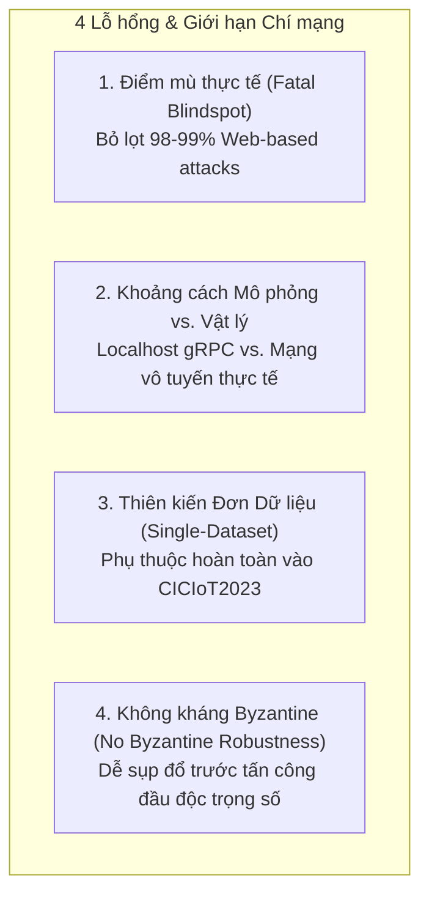

# ⚠️ Ghi chú 03: Lỗ hổng Hệ thống, Giới hạn Nghiên cứu & Biện pháp Biện minh

> **Tài liệu tham chiếu nội bộ cho Khóa luận Tốt nghiệp:**  
> *Xây dựng và đánh giá Prototype hệ thống phát hiện xâm nhập IoT sử dụng Federated Learning trong môi trường dữ liệu Non-IID*  
> **Sinh viên thực hiện:** Nguyễn Việt Kỳ Quân — 23521267 | **CBHD:** PGS. TS. Lê Trung Quân

---

## 1. Tầm quan trọng của việc Nhận diện Điểm yếu

Một nghiên cứu khoa học có giá trị cao không phải là nghiên cứu vẽ ra bức tranh "hoàn hảo không tì vết", mà là nghiên cứu **chỉ rõ tường tận ranh giới hiệu lực (Validity Boundary)** và **những điểm dễ bị tổn thương nhất (Critical Vulnerabilities)** của hệ thống. 

Khi sinh viên tự mình chủ động vạch ra các điểm yếu này trong báo cáo và slide bảo vệ, sinh viên sẽ chuyển từ thế **bị động phòng thủ** sang thế **chủ động dẫn dắt học thuật**.

---

## 2. Chi tiết 4 Lỗ hổng Chí mạng & Lập luận Biện minh (Defensive Arguments)

### 2.1. Lỗ hổng 1: "Điểm mù chết người" (Fatal Blindspot) đối với Tấn công Web-based

* **Bản chất vấn đề:**
  - Mô hình FL đạt Overall Accuracy $\approx 84.5\%$ và Macro-F1 $\approx 67.5\%$, nhưng tỷ lệ phát hiện (Recall) của lớp `Web-based` chỉ đạt từ **$0.39\%$ đến $1.66\%$** (thậm chí $0.00\%$ ở FedProx).
  - Trong thực tế vận hành (Production), điều này đồng nghĩa với việc: **Hệ thống bỏ lọt tới $98\% - 99\%$ các cuộc tấn công web** (SQL Injection, Cross-Site Scripting - XSS, Command Injection). Tin tặc chỉ cần gửi 1 payload web độc hại là có thể chiếm đoạt máy chủ điều khiển IoT mà hệ thống NIDS hoàn toàn không hay biết.
* **Góc nhìn của Reviewer:** *"Hệ thống này không thể đưa vào thực tế vì để lọt một lỗ hổng an ninh sơ đẳng và nguy hiểm nhất."*
* **Lập luận Biện minh & Giải pháp Khắc phục (Mitigation):**
  1. **Không coi FL-NIDS là giải pháp an ninh duy nhất (Stand-alone NIDS):** Trong kỹ nghệ an toàn thông tin, không bao giờ dùng duy nhất một mô hình học máy cho toàn bộ bề mặt tấn công.
  2. **Định vị trong Kiến trúc Phòng thủ Chiều sâu (Defense-in-Depth):**
     - **Tầng Ứng dụng (L7):** Các cuộc tấn công Web-based đòi hỏi phân tích sâu payload nội dung HTTP/HTTPS $\implies$ Phải do Web Application Firewall (WAF - ví dụ: ModSecurity, Cloudflare) hoặc Signature-based IDS (Suricata/Snort với tập luật chuỗi) đảm nhiệm.
     - **Tầng Mạng/Giao vận (L3/L4 - Prototype của đề tài):** Mô hình FL phát huy sức mạnh tối đa ở việc phát hiện các cuộc tấn công lưu lượng thể tích lớn (Volumetric Attacks) như DDoS, DoS, Reconnaissance, Spoofing, Mirai Botnet với độ chính xác và Recall vượt trội ($>90\% - 99\%$).

---

### 2.2. Lỗ hổng 2: Khoảng cách giữa "Mô phỏng Đa tiến trình gRPC" và "Mạng IoT Vật lý"

* **Bản chất vấn đề:**
  - Đề tài chạy $K=5, 7, 10$ client dưới dạng các tiến trình Python độc lập (`multiprocessing`) trên cùng một máy chủ/Colab, giao tiếp với server Flower qua địa chỉ loopback `localhost:8080`.
  - Môi trường này bỏ qua các đặc tính nhiễu động của mạng vô tuyến thực tế:
    - **Mất gói và độ trễ biến thiên (Packet loss, jitter, latency spikes):** Kết nối 4G/5G, Wi-Fi 802.11ah, hoặc LoRaWAN có độ ổn định kém hơn loopback socket rất nhiều.
    - **Mất kết nối đột ngột (Client Dropouts):** Thiết bị IoT hết pin, bị mất sóng giữa chừng không gửi được weights về server.
    - **Không đồng nhất phần cứng (Hardware Heterogeneity / Stragglers):** Trong thực tế, Client A có thể là Raspberry Pi 3 (tốc độ xử lý chậm gấp 10 lần), trong khi Client B là Edge Server có GPU, dẫn đến hiện tượng trạm chậm (stragglers) làm nghẽn toàn bộ vòng huấn luyện đồng bộ.
* **Góc nhìn của Reviewer:** *"Mô phỏng trên một máy tính chỉ là giả lập phần mềm, chưa phản ánh được tính phức tạp của hệ thống phân tán thực tế."*
* **Lập luận Biện minh:**
  1. **Tiến bộ vượt bậc so với các đồ án thông thường:** Đa số các đồ án sinh viên chỉ dùng vòng lặp `for` chạy tuần tự trong bộ nhớ chung (in-memory simulation). Đề tài này đã hiện thực hóa giao thức nhị phân gRPC thật, serialize/deserialize tham số nhị phân qua socket thật, và quản lý tiến trình độc lập.
  2. **Giá trị của Prototype:** Mục tiêu của prototype là xác minh tính khả thi về mặt kiến trúc phần mềm phân tán, đo kiểm footprint bộ nhớ thực tế (~54 KB/mô hình), và loại trừ các lỗi hệ điều hành (như deadlock pipe buffer 64KB).
  3. **Quy hoạch vào Hướng phát triển:** Việc mô phỏng trễ mạng qua Mininet-WiFi / ns-3 hoặc triển khai trên cụm thiết bị nhúng thực tế (Raspberry Pi/Jetson Nano) là giai đoạn tiếp theo của đề tài.

---

### 2.3. Lỗ hổng 3: Thiên kiến Đơn Dữ liệu (Single-Dataset Bias)

* **Bản chất vấn đề:**
  - Toàn bộ kết quả, phân tích Dirichlet, và kết luận suy thoái đều được rút ra từ tập dữ liệu **CICIoT2023**.
  - Mô hình có thể bị phụ thuộc vào phân bố thuộc tính (feature distribution) và kịch bản tấn công đặc thù của phòng thí nghiệm tạo ra CICIoT2023.
* **Góc nhìn của Reviewer:** *"Các kết luận về ngưỡng suy thoái Dirichlet hay sự bất lực của FedProx có thể chỉ đúng trên CICIoT2023 mà không tổng quát hóa trên các tập dữ liệu khác."*
* **Lập luận Biện minh:**
  1. **Quy mô của CICIoT2023:** Đây là tập dữ liệu an ninh mạng IoT lớn nhất và cập nhật nhất hiện nay (Neto et al., 2023), thu thập từ hệ thống thử nghiệm thực tế gồm hơn 105 thiết bị IoT thông minh với 33 phân loại tấn công khác nhau và hơn 46.6 triệu bản ghi mạng.
  2. **Tính nghiêm ngặt trong phân vùng:** Dữ liệu được phân chia thành 8 nhóm tấn công đại diện và kiểm soát chia Dirichlet chặt chẽ, tạo ra cơ sở thực nghiệm có độ tin cậy nội tại cao.
  3. **Thừa nhận học thuật:** Khóa luận ghi nhận việc thử nghiệm chéo trên tập dữ liệu thứ hai (như Edge-IIoTset hoặc TON_IoT) là yêu cầu cần thiết cho việc công bố bài báo tạp chí quốc tế.

---

### 2.4. Lỗ hổng 4: Thiếu Cơ chế Phòng thủ Tấn công Đầu độc (No Byzantine Robustness)

* **Bản chất vấn đề:**
  - Cả FedAvg và FedProx đều dựa trên giả định: **Tất cả các client tham gia đều trung thực (Benign Clients).**
  - Trong thực tế mạng IoT, các thiết bị biên rất dễ bị hacker xâm nhập vật lý hoặc cài mã độc. Nếu chỉ cần 1 trong 10 client bị chiếm quyền điều khiển và gửi các trọng số độc hại (ví dụ: gán trọng số cực lớn, đảo ngược dấu gradient, hoặc cấy cửa sau - backdoor):
    $$w_{t+1} = \sum_{k=1}^{K-1} \frac{n_k}{N} w_{t+1}^k + \frac{n_{\text{malicious}}}{N} w_{\text{poisoned}} \implies \text{Toàn bộ mô hình toàn cục bị phá hủy!}$$
* **Góc nhìn của Reviewer:** *"Hệ thống hoàn toàn mất an toàn trước các cuộc tấn công đối kháng (Adversarial / Poisoning Attacks)."*
* **Lập luận Biện minh:**
  1. **Phân định phạm vi bài toán:** Khóa luận tập trung nghiên cứu **Tính không đồng nhất thống kê (Statistical Heterogeneity - Non-IID)** và **Mất cân bằng lớp (Class Imbalance)**, chưa mở rộng sang phạm trù **Bảo mật đối kháng (Adversarial Security / Byzantine Fault Tolerance)**.
  2. **Khả năng mở rộng đã có sẵn trong mã nguồn:** Hệ thống đã được thiết kế hướng module cao. Trong module `src/federated/strategies.py`, codebase đã có cấu trúc tích hợp các chiến lược tổng hợp kháng Byzantine (như `FedMedian`, `FedTrimmedMean`, `Krum`), cho phép kích hoạt và đánh giá trong các nghiên cứu nâng cao.

---

## 3. Tóm tắt Bảng Phản xạ Nhanh cho Sinh viên khi Bị Chất vấn

| Lỗ hổng bị hỏi | Cách trả lời trong 30 giây |
| :--- | :--- |
| **Bỏ lọt Web-based 99%** | *"Dạ đúng ạ, đây chính là phát hiện phản nghiệm cốt lõi của đề tài: FedAvg/FedProx không thể giải quyết lớp cực hiếm. Trong kiến trúc an ninh thực tế, hệ thống này đóng vai trò tầng L3/L4 chuyên trị DDoS/DoS/Botnet, kết hợp cùng WAF ở tầng L7 để tạo thành mô hình Phòng thủ Chiều sâu (Defense-in-Depth)."* |
| **Mô phỏng trên 1 máy** | *"Dạ hệ thống dùng gRPC socket nhị phân và đa tiến trình độc lập để đo kiểm chính xác footprint 54KB và lưu lượng 10.6MB. Các nhiễu động vô tuyến vật lý em đã phân tích ở phần Giới hạn và quy hoạch kiểm thử trên Mininet-WiFi ở giai đoạn tiếp theo ạ."* |
| **Chỉ dùng 1 dataset** | *"Dạ CICIoT2023 là benchmark lớn nhất hiện nay với 105 thiết bị thực tế. Để nâng cấp thành bài báo quốc tế, hướng phát triển chắc chắn sẽ mở rộng kiểm chứng chéo trên Edge-IIoTset để đảm bảo tính tổng quát hóa cao nhất."* |
| **Không chống đầu độc** | *"Dạ phạm vi khóa luận giới hạn ở độ lệch thống kê Non-IID. Tuy nhiên kiến trúc phần mềm đã được thiết kế module hóa sẵn sàng tích hợp các chiến lược kháng Byzantine như FedMedian và FedTrimmedMean trong mã nguồn ạ."* |
