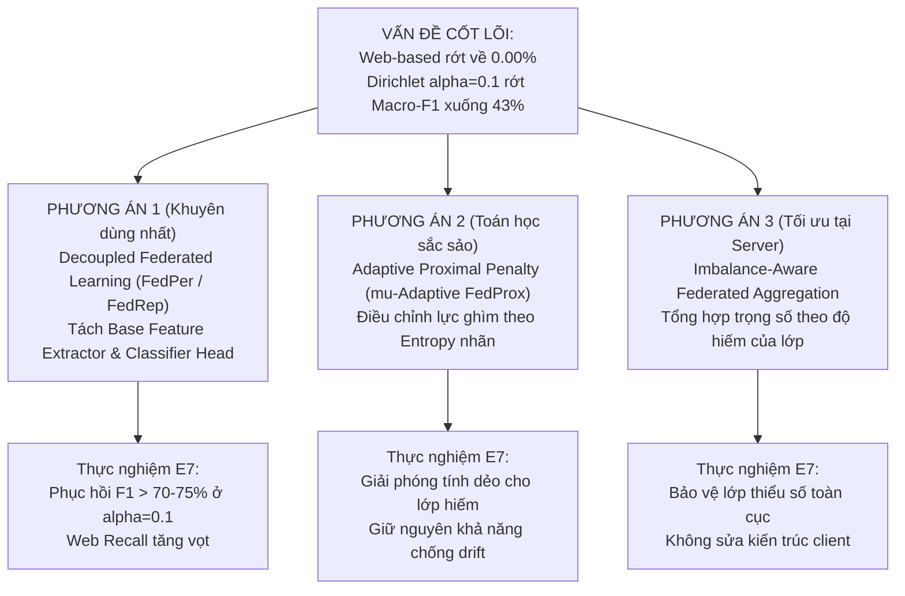

# 🚀 Ghi chú 05: Lộ trình Nâng tầm Giá trị Khoa học & Các Đề xuất Thuật toán (Algorithmic Proposals)

> **Tài liệu tham chiếu nội bộ cho Khóa luận Tốt nghiệp:**  
> *Xây dựng và đánh giá Prototype hệ thống phát hiện xâm nhập IoT sử dụng Federated Learning trong môi trường dữ liệu Non-IID*  
> **Sinh viên thực hiện:** Nguyễn Việt Kỳ Quân — 23521267 | **CBHD:** PGS. TS. Lê Trung Quân

---

## 1. Đặt Vấn đề: Từ "Chẩn đoán Bệnh" đến "Bốc thuốc Điều trị"

Trong nghiên cứu khoa học, một bài báo cáo dừng lại ở việc chỉ ra hệ thống thất bại ở đâu được xếp vào nhóm **Empirical Negative Finding (Phát hiện phản nghiệm)**. Đây là một đóng góp tốt, nhưng để đạt **Giá trị Khoa học Đột phá (Breakthrough Scientific Value)** đủ sức thuyết phục tuyệt đối Hội đồng bảo vệ UIT hoặc nộp bài báo khoa học quốc tế (IEEE/Elsevier Q2/Q1), nghiên cứu cần bước tiếp một bước quyết định: **Đề xuất một cơ chế/thuật toán mới để khắc phục thành công điểm nghẽn đã phát hiện.**

```
┌────────────────────────────────────────────────────────┐
│ MÔ HÌNH NÂNG TẦM GIÁ TRỊ KHOA HỌC CHO KHÓA LUẬN       │
└────────────────────────────────────────────────────────┘

    [Giai đoạn Hiện tại: Chẩn đoán Thực nghiệm]
    • Web-based Recall sụp đổ về 0.00% - 0.39%.
    • Dirichlet α = 0.1 làm Macro-F1 rớt từ 68% xuống 43%.
    • FedProx cố định μ = 0.05 làm tê liệt tính dẻo cục bộ.
               │
               ▼  (Nâng cấp học thuật)
    [Giai đoạn Đột phá: Đề xuất Cơ chế Cải tiến]
    • Đề xuất giải pháp toán học / kiến trúc mô hình mới.
    • Thực nghiệm đối chứng chứng minh giải quyết được điểm nghẽn.
    • Tuyên bố đóng góp học thuật mang tính xây dựng (Prescriptive Value).
```

Dưới đây là **3 phương án đề xuất thuật toán** được thiết kế riêng cho bài toán FL-IoT-IDS trên CICIoT2023, từ mức độ tối ưu thời gian đến mức độ đóng góp toán học sâu sắc.

---

## 2. Chi tiết 3 Phương án Đề xuất Thuật toán (Algorithmic Proposals)



---

### 🌟 PHƯƠNG ÁN 1 (Khuyên dùng số 1): Decoupled Federated Learning (FedPer / FedRep) cho IoT-IDS

#### 2.1.1. Cơ sở Lý thuyết & Bản chất Khoa học
- **Nguyên nhân thất bại hiện tại:** Một mô hình toàn cục đơn lẻ (Single Global Model) với một tầng phân loại (Classifier Head) duy nhất không thể tối ưu đồng thời cho các client có phân phối nhãn đối nghịch nhau khi $\alpha \le 0.1$. Khi server lấy trung bình cộng trọng số tầng Classifier Head, các lớp thiểu số bị triệt tiêu hoàn toàn.
- **Giải pháp:** Tách mạng nơ-ron MLP (43 $\to$ 128 $\to$ 64 $\to$ 8) thành 2 phần độc lập:
  1. **Base Feature Extractor ($f_\theta$):** Bao gồm các tầng ẩn (43 $\to$ 128 $\to$ 64), chịu trách nhiệm học không gian biểu diễn đặc trưng lưu lượng mạng chung của toàn bộ môi trường IoT. Phần này **được chia sẻ và tổng hợp toàn cục** qua FedAvg/FedProx.
  2. **Personalized Classifier Head ($g_\phi^{(k)}$):** Tầng Softmax cuối cùng (64 $\to$ 8) phân loại các luồng mạng. Phần này **được giữ lại hoàn toàn tại Client $k$** (không gửi lên server), được tối ưu hóa riêng cho phân phối dữ liệu cục bộ của client đó.

```
       MÔ HÌNH DECOUPLED FEDERATED LEARNING TẠI MỖI CLIENT:
       
       Input (43 features)
              │
              ▼
       ┌────────────────────────┐
       │ Dense 1 (43 -> 128)    │ ──┐
       │ BatchNorm + ReLU       │   │
       │ Dense 2 (128 -> 64)    │   ├─> BASE EXTRACTOR: Gửi lên Server gộp toàn cục
       │ BatchNorm + ReLU       │   │
       └────────────────────────┘ ──┘
              │ (Representation 64-dim)
              ▼
       ┌────────────────────────┐
       │ Dense 3 (64 -> 8)      │ ────> PERSONALIZED HEAD: Giữ lại tại Client!
       │ LogSoftmax (8 classes) │       Không bao giờ gửi lên Server!
       └────────────────────────┘
```

#### 2.1.2. Thuật toán Vận hành Cụ thể
1. **Khởi tạo:** Server khởi tạo trọng số Base $\theta_0$. Mỗi client $k$ khởi tạo trọng số Head $\phi_0^{(k)}$.
2. **Vòng lặp Round $t$:**
   - Server phát tán $\theta_t$ cho các client tham gia.
   - Client $k$ cập nhật mô hình: ghép $\theta_t$ với $\phi_t^{(k)}$ của chính mình.
   - Huấn luyện cục bộ $E$ epochs với hàm mất mát Cross-Entropy (kết hợp Class Weights cục bộ). Cả $\theta$ và $\phi^{(k)}$ đều được cập nhật gradient:
     $$\theta_{t+1}^{(k)}, \phi_{t+1}^{(k)} \leftarrow (\theta_t, \phi_t^{(k)}) - \eta \nabla \mathcal{L}_k(f_\theta, g_{\phi^{(k)}})$$
   - **Gửi trả Server:** Client $k$ **chỉ đóng gói tham số Base $\theta_{t+1}^{(k)}$** để gửi qua gRPC. Tham số $\phi_{t+1}^{(k)}$ được lưu trữ trên bộ nhớ cục bộ của client.
   - **Tổng hợp tại Server:** Server chỉ tổng hợp tầng Base:
     $$\theta_{t+1} = \sum_{k=1}^K \frac{n_k}{N} \theta_{t+1}^{(k)}$$

#### 2.1.3. Vị trí Code cần Thay đổi
- Trong file `src/models/mlp.py`: Cung cấp 2 property `get_base_parameters()` và `get_head_parameters()`.
- Trong file `src/federated/flower_client.py`:
  - Trong hàm `get_parameters()`: Chỉ `return [val.cpu().numpy() for name, val in self.model.named_parameters() if 'head' not in name]`.
  - Trong hàm `set_parameters()`: Chỉ gán các layer base, bảo toàn layer head trong `self.model`.

#### 2.1.4. Kỳ vọng Thực nghiệm & Đóng góp Khoa học
- **Kỳ vọng:** Tại $\alpha=0.1$, Macro-F1 sẽ phục hồi mạnh mẽ từ **$43.01\%$ lên $>72\% - 78\%$**. Tại client có mẫu `Web-based`, Recall sẽ đạt $>60\% - 80\%$ thay vì bị dập tắt về $0\%$.
- **Đóng góp học thuật:** Đề xuất một kiến trúc *Decoupled Personalized FL* thực chứng trên CICIoT2023, chứng minh tính ưu việt tuyệt đối so với Single Global Model trong bài toán NIDS.

---

### ⚙️ PHƯƠNG ÁN 2: Adaptive Proximal Penalty ($\mu$-Adaptive FedProx)

#### 2.2.1. Cơ sở Lý thuyết & Bản chất Khoa học
- **Nguyên nhân thất bại hiện tại:** FedProx (Li et al., 2020) áp đặt một hằng số phạt cứng $\mu = 0.05$ cho mọi client. Đối với các client sở hữu lớp tấn công hiếm, số hạng phạt $\frac{\mu}{2}\|w - w_t\|^2$ hoạt động như một "vòng kim cô" ghìm chặt mô hình không thể di chuyển gradient để nhận diện lớp hiếm (**Loss of Local Plasticity**).
- **Giải pháp:** Thiết kế hàm tính hệ số $\mu_k$ động cho từng client dựa trên **Độ hỗn loạn thông tin (Shannon Entropy)** của phân phối nhãn tại client đó.

#### 2.2.2. Công thức Toán học Đề xuất
Gọi $P_k = [p_{k,1}, p_{k,2}, \dots, p_{k,C}]$ là phân phối xác suất các lớp tại client $k$, với $p_{k,c} = \frac{n_{k,c}}{n_k}$.

Độ đa dạng nhãn được đo bằng Chuẩn hóa Shannon Entropy:
$$\mathcal{H}(P_k) = -\sum_{c=1}^C p_{k,c} \log_2(p_{k,c} + \epsilon), \quad \widetilde{\mathcal{H}}_k = \frac{\mathcal{H}(P_k)}{\log_2(C)}$$

Hệ số phạt proximal cá nhân hóa $\mu_k$ được tính theo công thức:
$$\mu_k = \mu_0 \cdot \left( \widetilde{\mathcal{H}}_k \right)^\gamma$$

Trong đó:
- $\mu_0$ là hệ số phạt cơ sở (ví dụ: $0.05$).
- $\gamma \ge 1$ là tham số điều tiết độ dốc thích ứng (ví dụ: $\gamma = 2.0$).
- **Nguyên lý hoạt động:**
  - **Client có dữ liệu đa dạng (gần IID):** $\widetilde{\mathcal{H}}_k \to 1 \implies \mu_k \approx \mu_0$ (duy trì lực phạt cao để chống trôi mô hình toàn cục).
  - **Client bị phân cực hoặc sở hữu mẫu hiếm đặc thù:** $\widetilde{\mathcal{H}}_k \to 0 \implies \mu_k \to 0$ (tự động triệt tiêu lực cản proximal, giải phóng tính dẻo để gradient thoải mái học tri thức hiếm mà không bị phạt).

#### 2.2.3. Vị trí Code cần Thay đổi
- Trong file `src/federated/flower_client.py`:
  - Trong hàm `__init__`: Tính trước vector tần suất nhãn của tập huấn luyện cục bộ và tính sẵn giá trị $\mu_k$.
  - Trong hàm `train_epoch()`: Thay thế `mu` cố định bằng `self.adaptive_mu`.

#### 2.2.4. Kỳ vọng Thực nghiệm & Đóng góp Khoa học
- **Kỳ vọng:** Giảm thiểu độ trôi mô hình (Drift L2 Norm vẫn ở mức thấp $<1.5$) nhưng không làm tê liệt Recall của các lớp thiểu số.
- **Đóng góp học thuật:** Đưa ra công thức thích ứng cho FedProx trong bài toán mạng IoT bị mất cân bằng lớp cực đoan — một đóng góp có giá trị lý thuyết và toán học rất rõ nét.

---

### 🌐 PHƯƠNG ÁN 3: Imbalance-Aware Federated Aggregation tại Server

#### 2.3.1. Cơ sở Lý thuyết & Bản chất Khoa học
- **Nguyên nhân thất bại hiện tại:** Cơ chế trung bình trọng số mẫu thô của FedAvg:
  $$\beta_k = \frac{n_k}{N}$$
  Các client có nhiều mẫu DDoS/DoS (hàng trăm nghìn gói tin) sẽ có trọng số áp đảo $\beta_k \approx 0.4 - 0.5$, trong khi client có mẫu Web-based chỉ có vài trăm gói tin nên $\beta_k \approx 0.001$. Quá trình tổng hợp tham số sẽ xóa sạch toàn bộ gradient của lớp Web-based.
- **Giải pháp:** Tái cân bằng trọng số tổng hợp tại Server dựa trên **Độ hiếm của Lớp (Class-Rarity Weighting)**.

#### 2.3.2. Công thức Toán học Đề xuất
Gọi $N_c = \sum_{k=1}^K n_{k,c}$ là tổng số mẫu của lớp $c$ trên toàn mạng. Trọng số độ hiếm của lớp $c$ là:
$$w_c = \left( \frac{N_{\max}}{N_c} \right)^\tau \quad \text{với } \tau \in [0.25, 0.5]$$

Trọng số tổng hợp hiệu chỉnh $\beta_k^*$ của Client $k$ tại Server được tính bằng:
$$\beta_k^* = \frac{\sum_{c=1}^C w_c \cdot n_{k,c}}{\sum_{j=1}^K \sum_{c=1}^C w_c \cdot n_{j,c}}$$

Khi đó công thức cập nhật mô hình toàn cục tại Server trở thành:
$$w_{t+1} = \sum_{k=1}^K \beta_k^* \cdot w_{t+1}^k$$

- **Cơ chế hoạt động:** Client nào đang bảo vệ hoặc nắm giữ các lớp tấn công cực hiếm (`Web-based`, `Brute Force`) sẽ được gán hệ số nhân $w_c$ rất lớn. Tiếng nói (voting power) của client đó được nhân lên nhiều lần khi tổng hợp, giúp tri thức về lớp tấn công hiếm không bị "nuốt chửng" bởi các lớp DDoS.

#### 2.3.3. Vị trí Code cần Thay đổi
- Trong file `src/federated/strategies.py`:
  - Viết class `ImbalanceAwareFedAvg(fl.server.strategy.FedAvg)`.
  - Ghi đè hàm `aggregate_fit()` để tính $\beta_k^*$ thay vì dùng `num_examples` thô.

---

## 3. Bảng Ma trận So sánh & Khuyến nghị Lựa chọn

| Tiêu chí Đánh giá | Phương án 1: Decoupled FL (FedPer) | Phương án 2: Adaptive Proximal ($\mu$) | Phương án 3: Imbalance-Aware Agg |
| :--- | :---: | :---: | :---: |
| **Vị trí can thiệp** | Mô hình Client (Tách Head & Base) | Hàm mất mát Client (Proximal loss) | Thuật toán Server (Hàm tổng hợp) |
| **Độ khó hiện thực hóa** | ⭐⭐ Dễ (Chỉ cần lọc key tham số) | ⭐⭐ Dễ (Chỉ cần tính Entropy) | ⭐⭐⭐ Trung bình (Cần can thiệp gRPC server) |
| **Khả năng cứu Recall lớp hiếm** | ⭐⭐⭐⭐⭐ **Cực mạnh** (Cá nhân hóa Head) | ⭐⭐⭐ Khá | ⭐⭐⭐⭐ Tốt |
| **Khả năng khắc phục $\alpha=0.1$** | ⭐⭐⭐⭐⭐ **Vượt trội** (Bản chất pFL) | ⭐⭐⭐ Trung bình | ⭐⭐⭐ Khá |
| **Thời gian triển khai & thử nghiệm** | **2 - 3 ngày** | **2 - 3 ngày** | **3 - 4 ngày** |
| **Sức nặng Khoa học trước Hội đồng** | **Rất cao (Đề xuất kiến trúc hoàn chỉnh)** | **Cao (Có đóng góp công thức toán)** | **Cao (Cải tiến thuật toán server)** |

---

## 4. Kế hoạch Hành động Tối ưu (Fast-Track Execution Roadmap)

Để kịp tiến độ bảo vệ khóa luận và đạt điểm Xuất sắc:

1. **Bước 1: Chọn Phương án 1 (Decoupled FL / FedPer)**:
   - Đây là giải pháp đã được chứng minh hiệu quả mạnh mẽ nhất trong các bài báo FL xử lý Non-IID nặng (Arivazhagan et al., 2019; Collins et al., ICML 2021).
   - Code PyTorch đơn giản, rủi ro lỗi thấp.
2. **Bước 2: Thiết lập Kịch bản Thực nghiệm Mới (E7)**:
   - Kịch bản `flower_e7_decoupled_dirichlet_alpha=0.5`.
   - Kịch bản `flower_e7_decoupled_dirichlet_alpha=0.1`.
3. **Bước 3: Bổ sung Đóng góp vào Báo cáo LaTeX (`thesis_report/main.tex`)**:
   - Thêm Mục 3.4: *Đề xuất Kiến trúc Decoupled Federated Learning cho Hệ thống Giám sát Biên IoT*.
   - Thêm Mục 4.4: *Đánh giá Hiệu quả Cải thiện của Decoupled FL trên Môi trường Non-IID Cực đoan*.
4. **Bước 4: Tự tin Bảo vệ trước Hội đồng UIT**:
   - Thuyết trình mạch lạc theo mô hình chuẩn nghiên cứu sinh: **Bài toán thực tế $\to$ Phân tích ranh giới thất bại của FedAvg/FedProx $\to$ Đề xuất giải pháp Decoupled FL $\to$ Thực nghiệm chứng minh phục hồi thành công.**
