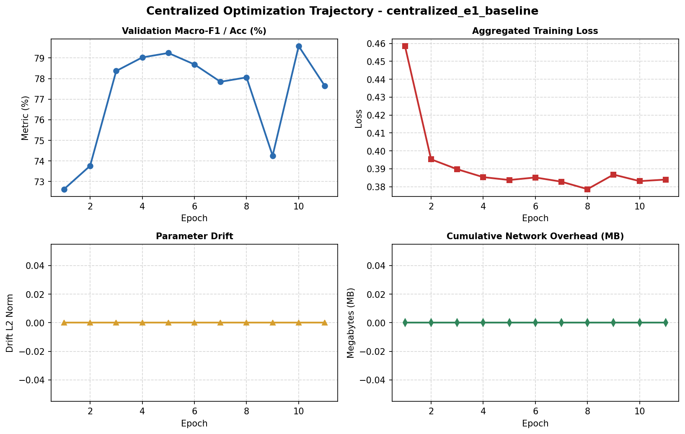
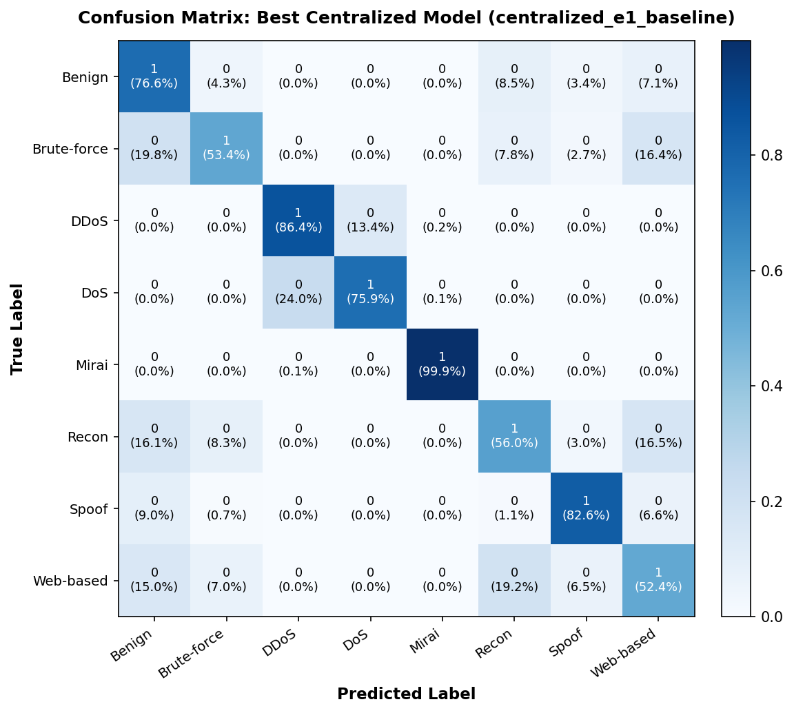
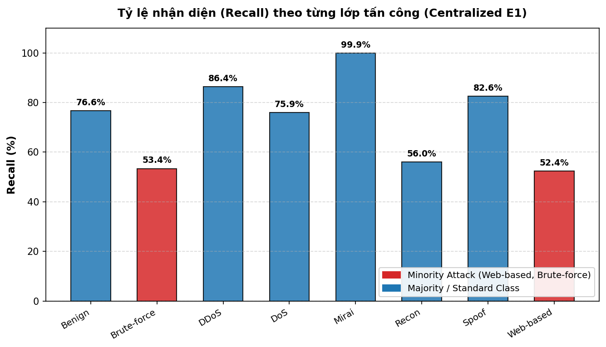

# 📊 Báo cáo Thực nghiệm Kịch bản: `centralized_e1_baseline`

## 1. Thông số Cấu hình Thực nghiệm (Centralized Upper Bound)
| Tham số | Giá trị | Ý nghĩa thực nghiệm |
| :--- | :--- | :--- |
| **Kịch bản (Scenario)** | `centralized_e1_baseline` | Scenario E1: Ngưỡng trần hiệu năng tập trung |
| **Chế độ huấn luyện** | `Centralized Training (PyTorch)` | Huấn luyện tập trung toàn bộ dữ liệu trên 1 Server |
| **Kiến trúc mô hình** | `TabularIoTMLPModel` | Mạng nơ-ron đa tầng cho dữ liệu bảng mạng IoT |
| **Số lượng Node/Client** | `1 Central Server` | Không phân mảnh dữ liệu (Không có phân vùng Client) |
| **Số Epoch huấn luyện** | `11 Epochs` | Huấn luyện tập trung với Early Stopping |
| **Chi phí truyền thông** | **0.00 MB** | Không phát sinh giao tiếp mạng phân tán |
| **Độ trôi dạt tham số** | **0.00** | Không có hiện tượng trôi dạt tham số (Client Drift) |

## 2. Kết quả Đánh giá Tổng thể trên Global Test Set (30% Upcoming Data)
| Chỉ số Đánh giá (Metric) | Kết quả (%) | Ý nghĩa theo Đề cương Luận văn KLTN |
| :--- | :---: | :--- |
| **Test Accuracy** | **78.69%** | Độ chính xác tổng thể trên toàn bộ lưu lượng kiểm định |
| **Macro-F1 Score** | **63.70%** | **Chỉ số cốt lõi** đánh giá cân bằng (không thiên lệch lớp đa số) |
| **Weighted-F1 Score** | **80.69%** | F1 có tính trọng số theo tần suất xuất hiện thực tế |
| **Macro-Precision** | **64.56%** | Độ chuẩn xác trung bình trên 8 lớp tấn công |
| **Macro-Recall** | **72.90%** | Tỷ lệ nhận diện trung bình trên 8 lớp tấn công |

## 3. Khả năng Phát hiện các Lớp Tấn công Thiểu số (Minority Attack Recall)
> [!IMPORTANT]
> Trong môi trường mạng IoT, tấn công thiểu số (Web-based, Brute-force) có tần suất thấp nhưng mức độ đe dọa cao, là trọng tâm đánh giá của Luận văn.

| Lớp tấn công thiểu số | Tần suất xuất hiện | Tỷ lệ nhận diện (Recall %) | Nhận xét |
| :--- | :---: | :---: | :--- |
| **Web-based** | 0.49% (Rất hiếm) | **52.41%** | Phát hiện tốt |
| **Brute-force** | 0.26% (Rất hiếm) | **53.36%** | Phát hiện tốt |

## 4. Chi tiết Hiệu năng theo từng Lớp Tấn công (Per-Class Metrics)
| Lớp tấn công (Class) | Phân loại | Precision (%) | Recall (%) | F1-Score (%) | Số mẫu (Support) |
| :--- | :---: | :---: | :---: | :---: | :---: |
| **Benign** | Đa số / Chuẩn | 84.35% | 76.64% | 80.31% | 329,458 |
| **Brute-force** | Thiểu số (Minority) | 5.97% | 53.36% | 10.73% | 3,919 |
| **DDoS** | Đa số / Chuẩn | 90.45% | 86.41% | 88.38% | 576,601 |
| **DoS** | Đa số / Chuẩn | 68.32% | 75.90% | 71.91% | 219,103 |
| **Mirai** | Đa số / Chuẩn | 97.71% | 99.88% | 98.78% | 63,247 |
| **Recon** | Đa số / Chuẩn | 78.75% | 56.02% | 65.47% | 207,160 |
| **Spoof** | Đa số / Chuẩn | 85.42% | 82.58% | 83.98% | 127,981 |
| **Web-based** | Thiểu số (Minority) | 5.53% | 52.41% | 10.01% | 7,449 |

## 5. Trực quan hóa Đồ thị Thực nghiệm
### 📈 Quỹ đạo Hội tụ và Chi phí Mạng (Convergence & Communication)

### 🎯 Ma trận Nhầm lẫn Toàn diện (Normalized Confusion Matrix 8x8)

### 📊 Tỷ lệ Nhận diện theo Lớp & Tấn công Thiểu số (Per-Class Recall)

