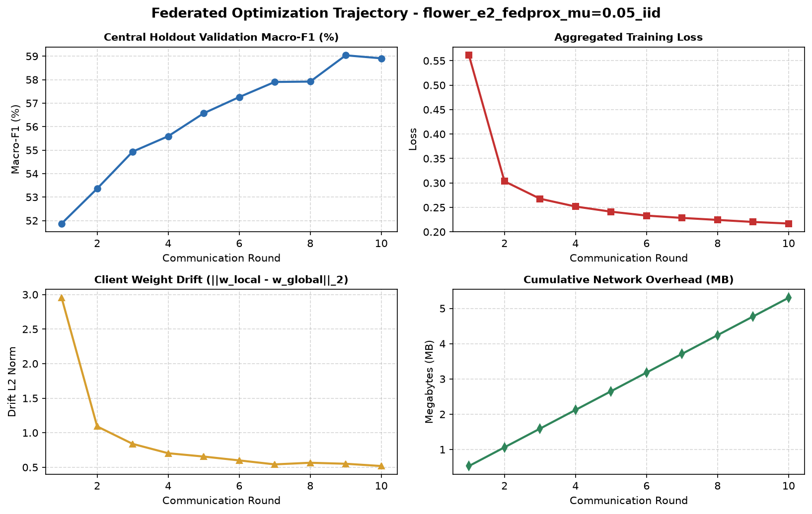
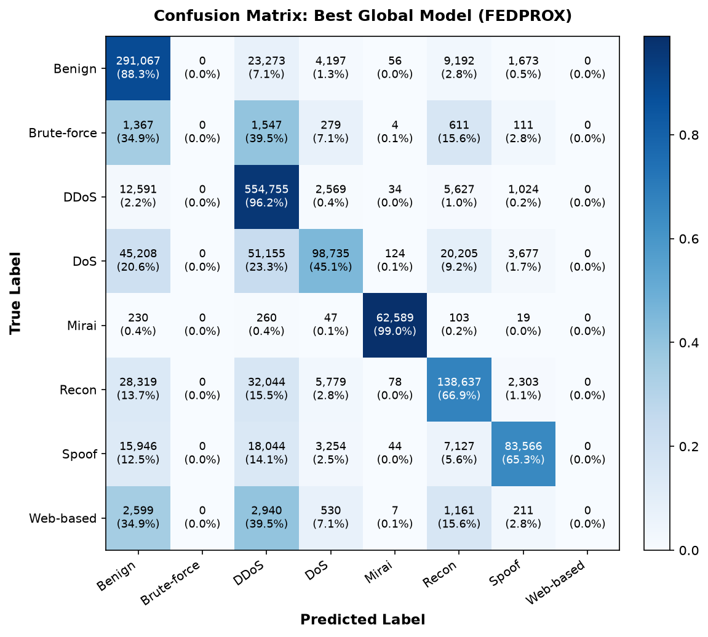
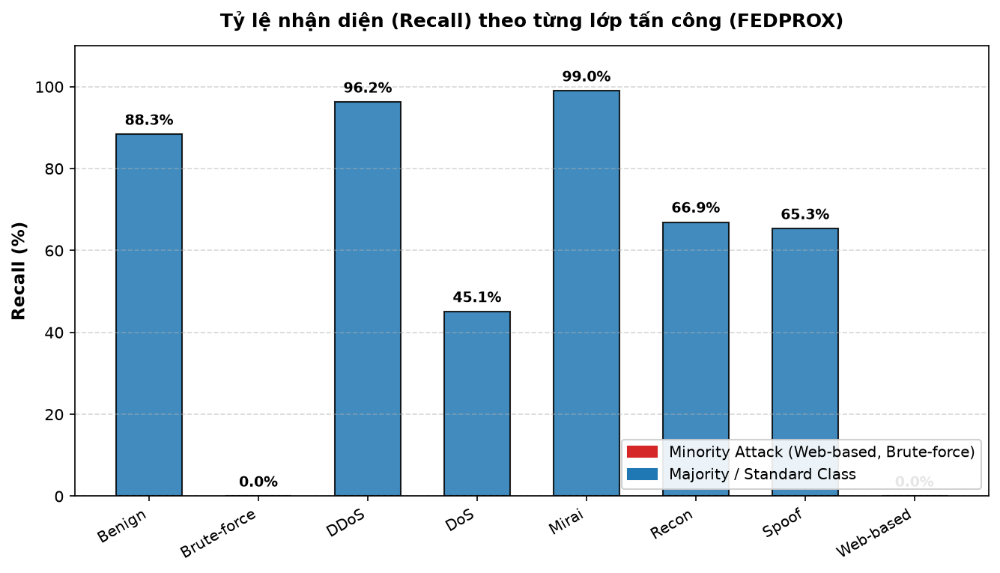

# 📊 Báo cáo Thực nghiệm Kịch bản: `flower_e2_fedprox_mu=0.05_iid`

## 1. Thông số Cấu hình Thực nghiệm
| Tham số | Giá trị | Ý nghĩa thực nghiệm |
| :--- | :--- | :--- |
| **Kịch bản (Scenario)** | `flower_e2_fedprox_mu=0.05_iid` | Tên định danh kịch bản thực nghiệm |
| **Chiến lược FL (Strategy)** | `FEDPROX` (mu=0.05) | Thuật toán tổng hợp tham số tại Server |
| **Phân vùng dữ liệu (Partition)** | `iid` (alpha=0.5) | Mức độ dị biệt Non-IID giữa các Client |
| **Số lượng Edge Clients (K)** | `5` clients | Số trạm mạng IoT biên tham gia huấn luyện |
| **Số vòng giao tiếp (Rounds)** | `10` rounds (Epochs cục bộ: `2`) | Tổng chu kỳ huấn luyện liên đoàn |
| **Chi phí truyền thông (Comm Cost)** | **5.30 MB** | Tổng lưu lượng mạng tải lên/tải xuống |
| **Độ trôi dạt tham số (Client Drift)** | **0.52** | Độ lệch chuẩn Euclidean ||w_local - w_global||_2 |

## 2. Kết quả Đánh giá Tổng thể trên Global Test Set (30% Upcoming Data)
| Chỉ số Đánh giá (Metric) | Kết quả (%) | Ý nghĩa theo Đề cương Luận văn KLTN |
| :--- | :---: | :--- |
| **Test Accuracy** | **80.09%** | Độ chính xác tổng thể trên toàn bộ lưu lượng kiểm định |
| **Macro-F1 Score** | **59.06%** | **Chỉ số cốt lõi** đánh giá cân bằng (không thiên lệch lớp đa số) |
| **Weighted-F1 Score** | **78.70%** | F1 có tính trọng số theo tần suất xuất hiện thực tế |
| **Macro-Precision** | **62.73%** | Độ chuẩn xác trung bình trên 8 lớp tấn công |
| **Macro-Recall** | **57.60%** | Tỷ lệ nhận diện trung bình trên 8 lớp tấn công |

## 3. Khả năng Phát hiện các Lớp Tấn công Thiểu số (Minority Attack Recall)
> [!IMPORTANT]
> Trong môi trường mạng IoT, tấn công thiểu số (Web-based, Brute-force) có tần suất thấp nhưng mức độ đe dọa cao, là trọng tâm đánh giá của Luận văn.

| Lớp tấn công thiểu số | Tần suất xuất hiện | Tỷ lệ nhận diện (Recall %) | Nhận xét |
| :--- | :---: | :---: | :--- |
| **Web-based** | 0.49% (Rất hiếm) | **0.00%** | Thách thức do mất cân bằng cực đoan |
| **Brute-force** | 0.26% (Rất hiếm) | **0.00%** | Cần tinh chỉnh loss/mu |

## 4. Chi tiết Hiệu năng theo từng Lớp Tấn công (Per-Class Metrics)
| Lớp tấn công (Class) | Phân loại | Precision (%) | Recall (%) | F1-Score (%) | Số mẫu (Support) |
| :--- | :---: | :---: | :---: | :---: | :---: |
| **Benign** | Đa số / Chuẩn | 73.19% | 88.35% | 80.06% | 329,458 |
| **Brute-force** | Thiểu số (Minority) | 0.00% | 0.00% | 0.00% | 3,919 |
| **DDoS** | Đa số / Chuẩn | 82.14% | 96.21% | 88.62% | 576,601 |
| **DoS** | Đa số / Chuẩn | 81.95% | 45.06% | 58.15% | 219,103 |
| **Mirai** | Đa số / Chuẩn | 99.54% | 98.96% | 99.25% | 63,247 |
| **Recon** | Đa số / Chuẩn | 74.42% | 66.92% | 70.47% | 207,160 |
| **Spoof** | Đa số / Chuẩn | 90.60% | 65.30% | 75.89% | 127,981 |
| **Web-based** | Thiểu số (Minority) | 0.00% | 0.00% | 0.00% | 7,449 |

## 5. Trực quan hóa Đồ thị Thực nghiệm
### 📈 Quỹ đạo Hội tụ và Chi phí Mạng (Convergence & Communication)

### 🎯 Ma trận Nhầm lẫn Toàn diện (Normalized Confusion Matrix 8x8)

### 📊 Tỷ lệ Nhận diện theo Lớp & Tấn công Thiểu số (Per-Class Recall)

